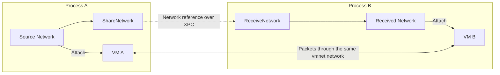

# Configure and share a network

These APIs require macOS 26 or later.

## Configure a network

Pass functional options to `NewNetworkConfiguration`. The returned
configuration is immutable and can be passed to `NewNetwork`:

```go
config, err := vmnet.NewNetworkConfiguration(
    vmnet.ModeShared,
    vmnet.WithIPv4Subnet(netip.MustParsePrefix("192.168.120.0/24")),
    vmnet.WithIPv6Prefix(netip.MustParsePrefix("fd42:1234:120::/64")),
    vmnet.WithDHCPReservation(
        net.HardwareAddr{0x02, 0, 0, 0, 0, 1},
        netip.MustParseAddr("192.168.120.10"),
    ),
    vmnet.WithMTU(1500),
)
if err != nil {
    return err
}
network, err := vmnet.NewNetwork(config)
if err != nil {
    return err
}
```

Import `net` and `net/netip` for the address types in this example.

Options are validated before native configuration is created. The last IPv4
subnet, IPv6 prefix, or MTU wins. DHCP reservations accumulate by MAC address;
repeating a MAC replaces its address. Invalid options return an error even if
a later option would replace them.

Reservations are checked against the final IPv4 subnet, regardless of option
order. When the subnet is selected automatically, `NewNetwork` checks
reservations against the actual subnet. `WithDHCPReservation` copies the MAC
address when the option is created, so options can be reused independently.

`WithMTU` accepts 1280 through 65535 bytes. This range enforces the IPv6 minimum
and Darwin interface maximum; vmnet can still reject a value within the range.

### Disable network services

These options apply vmnet's service-disable settings. Omit an option to
preserve vmnet's default for the selected mode. The options can be combined,
repeated, and reused across configurations.

| Option | Effect |
| --- | --- |
| `WithDHCPDisabled()` | Disables the DHCP server. Configure guest IPv4 addresses manually or provide another DHCP server. |
| `WithDNSProxyDisabled()` | Requests that vmnet disable the DNS proxy. Configure guests to use another DNS resolver. |
| `WithNAT44Disabled()` | Disables IPv4 NAT. External IPv4 traffic needs another route. |
| `WithNAT66Disabled()` | Disables IPv6 NAT. External IPv6 traffic needs another route. |
| `WithRouterAdvertisementDisabled()` | Disables IPv6 router advertisements. Configure guest IPv6 addresses and routes manually or provide another advertising router. |

For example, to use static guest addresses without vmnet's DHCP server or IPv6
router advertisements:

```go
config, err := vmnet.NewNetworkConfiguration(
	vmnet.ModeShared,
	vmnet.WithDHCPDisabled(),
	vmnet.WithRouterAdvertisementDisabled(),
)
if err != nil {
	return err
}
```

These options do not configure guest addresses, routes, or DNS resolvers.
`WithDNSProxyDisabled` does not filter DNS traffic or guarantee that queries to
the host receive no response.

## Share a network between processes

`CopySerialization` returns an opaque XPC object. `NewNetworkWithSerialization`
restores a network from that object. The serialization is not a byte encoding
and cannot be written to a file.

Use `ShareNetwork` and `ReceiveNetwork` to share a network through a launchd
Mach service.



XPC transfers the network reference. VM packets flow through the shared vmnet
network. Keep the sharing service and its process running while clients use
the network.

The server publishes one network:

```go
service, err := vmnet.ShareNetwork("com.example.vmnetwork", network, clientRequirement)
if err != nil {
	return err
}
defer service.Close()
```

The client obtains its own network reference:

```go
ctx, cancel := context.WithTimeout(context.Background(), 5*time.Second)
defer cancel()
network, err := vmnet.ReceiveNetwork(ctx, "com.example.vmnetwork", serverRequirement)
if err != nil {
	return err
}
```

Pass the received network to `vz.NewVMNetNetworkDeviceAttachment` or
`vmnet.StartInterfaceWithNetwork`. Keep the service open and its process
running while clients use the shared network. The service retains the source
network until it closes. A received reference does not preserve the source
network reservation after the server releases it.

Register the service name in the server's launchd property list:

```xml
<key>MachServices</key>
<dict>
    <key>com.example.vmnetwork</key>
    <true/>
</dict>
```

The property list also needs `Label` and `ProgramArguments`. Load a user agent
with `launchctl bootstrap gui/$(id -u) /path/to/service.plist` and remove it with
`launchctl bootout gui/$(id -u)/com.example.vmnetwork`, using its label in the
second command. `ShareNetwork` does not register the name with launchd.
Connection and registration failures can be reported asynchronously by XPC.
Use a deadline when receiving a network.

Both functions require an Apple code signing requirement expression for the
remote executable. For binaries signed with a Developer ID certificate, a
requirement can combine the signing identifier and team identifier:

```text
anchor apple generic and identifier "com.example.vmhost" and certificate leaf[subject.OU] = "TEAMID1234"
```

For development with one ad hoc signed executable, use `cdhash H"..."` with the
hash printed by `codesign -d -vvvv /path/to/executable`. Rebuilding or signing the
executable changes its hash. The server checks clients and each client checks
the server. An empty requirement is rejected. A requirement of `true` accepts
any executable and should not be used for a service that exposes a private
network.
